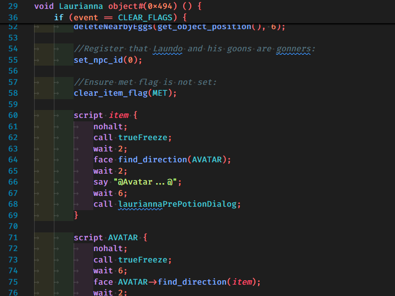

# Exult Usecode Syntax for VS Code

Syntax highlighting and formatting for Exult's UseCode C (UCC), with highlighting for UseCode Assembly files.

This extension provides TextMate-based grammars for UseCode source files (extensions: .ucc, .uc, .uh, .ucxt) and UseCode assembly (.uca). It focuses on accurate highlighting of keywords, types, numbers, strings, comments, directives, script commands, intrinsics, and labels.

## Features

- TextMate grammar for UseCode C (UCC) with:
  - Keywords, types, operators
  - Strings and escape sequences
  - Line and block comments
  - Directives (#include, #game, #line, etc.)
  - Intrinsic and user function highlighting
- TextMate grammar for UseCode Assembly (.uca) with mnemonics, labels, directives and comments
- Language configuration (brackets, auto-closing, surrounding pairs)
- UseCode C document formatter based on the Python `format_usecode.py` reference, with token-preserving whitespace edits
- Sample file included at `samples/test.uc` for testing and verification

## Installation

Install from the Marketplace once published, or test locally:

1. Install dependencies (for packaging, requires Node.js 24 or newer):

```bash
npm ci
```

1. Package locally:

```bash
npm run package
```

1. Install the produced `.vsix` in VS Code: open Command Palette -> "Extensions: Install from VSIX..."

Or run the extension in the Extension Development Host via the Debug view.

## Usage

- Open any UseCode source file (e.g. `*.uc`, `*.ucc`, `*.uh`, `*.ucxt`, `*.uca`). VS Code should auto-detect the language. If not, set the language mode at the bottom-right and choose "UseCode" or "Usecode Assembly".
- Use the included `samples/test.uc` as a quick verification of highlighting coverage.

Use **Format Document** in a UseCode C file to format braces, indentation, operators, labels, conversations, scripts, and long calls. The formatter respects the editor's tabs/spaces and tab size settings, preserves existing LF or CRLF line endings, and defaults to a preferred line width of 100 (`usecode.format.maxLineLength`, minimum 40). Strings and comments remain intact, and atomic tokens can exceed the preferred width. Files with unterminated literals or unbalanced delimiters are left unchanged; details appear in the **Usecode Formatter** output channel.

This extension is selected as the default formatter for all UseCode C file extensions. Language-specific user or workspace settings can override this default. UseCode Assembly files have highlighting only.

To enable formatting on save, add these settings:

```json
"[usecode]": {
    "editor.formatOnSave": true
}
```

## Screenshots

Include screenshots in `images/` and reference them here. Example:



_If no screenshot is present, the Marketplace will still display the README text; screenshots are recommended._

## Changelog

See `CHANGELOG.md` for release history.

## License

This project is licensed under GPL-2.0-or-later. See the `LICENSE` file for details.

## Contributing

Contributions are welcome. Please open an issue or pull request on the repository. When contributing:

- Add tests or examples where useful
- Keep grammar changes minimal and documented
- Include sample snippets or test cases for any new rules

Run `npm test` to compile the TypeScript extension and check formatting and highlighting with VS Code's TextMate and Oniguruma engines. Set `EXULT_ROOT` to an Exult checkout to also check intrinsic coverage against all three engine tables. `npm run compile` builds the extension into `out/`; packaging runs this build automatically.

Script words are scoped inside scheduled scripts, `new script` expressions, and script blocks appended with `<<`. Conversation blocks scope `fallthrough`, with ordinary identifier scopes restored inside loop and switch bodies. These TextMate contexts use balanced delimiters; complex unbraced loop bodies (such as an `if`/`else` body) and the exact transition between a loop header and its body remain approximations of the compiler's parser. Intrinsic names are highlighted independently of following call punctuation so comments and line breaks do not change their scopes; bare intrinsic names shadowed by user declarations retain intrinsic highlighting.

## Contact and repository

Please add repository information in `package.json` (repository, bugs, homepage) so the Marketplace page links to the source. Replace placeholders with your repository URL before publishing.

---

If you'd like, I can: add a placeholder `images/icon.png` and `images/screenshot1.png`, wire up a simple GitHub Actions workflow to package on push, and finish the remaining package.json metadata. Tell me which you'd prefer next.
